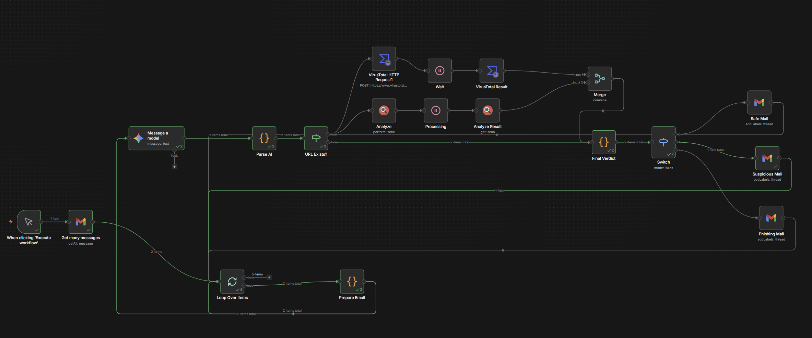

# phishing-sandbox-soar

AI-assisted email triage built as a SOAR playbook in **n8n**. It reads unread Gmail messages, analyzes the text with an LLM (Gemini), checks embedded URLs with **VirusTotal** and **urlscan.io**, and labels each email **Safe**, **Suspicious** or **Phishing**.

> Proof-of-concept reference architecture for learning and portfolio use. It supplements, and does not replace, a real email security gateway.



## The problem

An employee can receive 100+ emails a day. Nobody can inspect every link and every message. This workflow triages the inbox automatically, so people can skip what is labeled Phishing and review only what is labeled Suspicious.

## Architecture

```
Manual Trigger
  -> Get many messages   (unread, no Safe/Suspicious/Phishing label)
  -> Loop Over Items     (batch size 1)
       -> Prepare Email  (clean body, extract URLs, read SPF/DKIM/DMARC)
       -> Message a model (Gemini: scam | suspicious | legit)
       -> Parse AI       (validate JSON, fail-safe to "suspicious")
       -> URL Exists?
            true  -> VirusTotal + urlscan.io (parallel) -> Merge
            false ------------------------------------------+
       -> Final Verdict  (scanners override AI)  <-----------+
       -> Switch -> Safe / Suspicious / Phishing label
       -> back to Loop Over Items (next email)
```

Mapped to the NIST incident response lifecycle:

| Phase | Implementation |
|---|---|
| Detection | Gmail query for unread, unlabeled mail |
| Analysis | LLM text analysis, SPF/DKIM/DMARC, URL extraction |
| Enrichment | VirusTotal engines, urlscan.io sandbox |
| Decision | `Final Verdict` code node |
| Containment / response | Gmail label (Safe, Suspicious, Phishing) |

MITRE ATT&CK coverage: **T1566 Phishing** (including T1566.002 Spearphishing Link).

## Design decisions

- **Scanners override the AI.** If VirusTotal or urlscan.io flags a URL, the verdict is Phishing regardless of what the LLM says. This limits prompt-injection impact: an email cannot talk its way past a flagged link.
- **Fail-safe, not fail-open.** If the AI errors, rate-limits or returns invalid JSON, the email becomes **Suspicious**, never Safe.
- **One email at a time.** Keeps each email's scan results isolated and respects free-tier API rate limits.
- **Authentication as a signal.** SPF/DKIM/DMARC results are passed to the model and used in the verdict. Trusted-domain shortcuts only apply when DMARC passes.
- **Labels are idempotent.** The Gmail search excludes already-labeled mail, so a run never reprocesses it.

## Quick start

Full instructions are in [docs/SETUP.md](docs/SETUP.md). Summary:

1. `cp .env.example .env` and run `docker compose up -d`
2. Open http://localhost:5678 and create the owner account
3. Create credentials in n8n: Gmail OAuth2, Google Gemini, VirusTotal (header auth), urlscan.io
4. Create Gmail labels `Safe`, `Suspicious`, `Phishing`
5. Import `workflow/phishing-soar.json` and re-select credentials and labels in the nodes
6. Click **Execute workflow**

You always need your own API keys and Gmail labels. They are never stored in this repository.

## Repository layout

```
.
├── README.md
├── docker-compose.yml
├── .env.example
├── .gitignore
├── img/workflow.png
├── workflow/
│   ├── phishing-soar.json        sanitized n8n export
│   └── code/                     code used in the Code nodes (readable copies)
│       ├── prepare-email.js
│       ├── parse-ai.js
│       ├── final-verdict.js
│       └── gemini-system-prompt.txt
└── docs/
    ├── SETUP.md                  step-by-step installation
    ├── NODES.md                  what each node does
    └── TESTING.md                test plan and results table
```

## Results

Fill this in after testing (see [docs/TESTING.md](docs/TESTING.md)). Do not publish numbers you have not measured.

| Metric | Value |
|---|---|
| Test set size | _ legitimate, _ malicious |
| Detection rate (malicious labeled Suspicious or Phishing) | _ % |
| False positive rate (legitimate labeled Suspicious or Phishing) | _ % |

## Limitations

- **False negatives are possible.** Zero-day URLs, cloaking and sandbox evasion can pass scanners; well-written scams can pass the LLM.
- **LLM output is non-deterministic.** Temperature is set to 0, but verdicts can still vary.
- **Prompt injection** is a known risk; mitigated by letting scanners override the AI, not eliminated.
- **Only the first URL** in an email is scanned, to conserve API quota.
- **Free-tier quotas** (VirusTotal about 4 requests/min, Gemini and urlscan.io limits) make it unsuitable for high volume without paid tiers.
- Runs on demand; it is not a real-time gateway.

## Security and privacy

- Email text, headers and URLs are sent to third-party services (Google Gemini, VirusTotal, urlscan.io). Use a **test inbox**, or a local model, for anything sensitive.
- Free-tier AI services may use submitted data to improve their products. Use a paid or local model for real company mail.
- Never open URLs flagged as Phishing outside an isolated VM or sandbox.
- Never commit `.env`, `n8n_data/` or credentials. `n8n_data/` contains your encrypted credentials and encryption key.

## Disclaimer

This is an educational proof-of-concept. No tool guarantees 100% detection, and a "Safe" label means "no threat found", not "guaranteed safe". The author is not responsible for security incidents, data loss or system compromise resulting from its use. Use it as a supplement to, not a replacement for, enterprise-grade email security.
